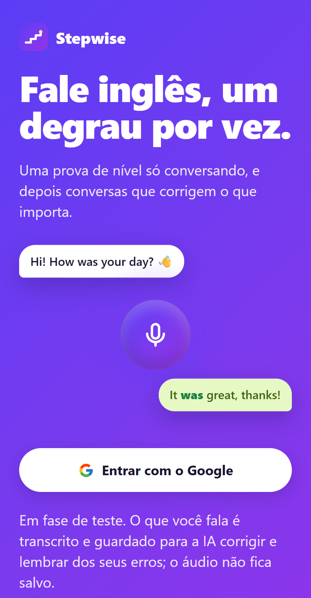
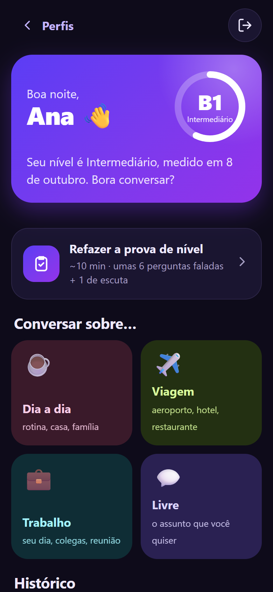
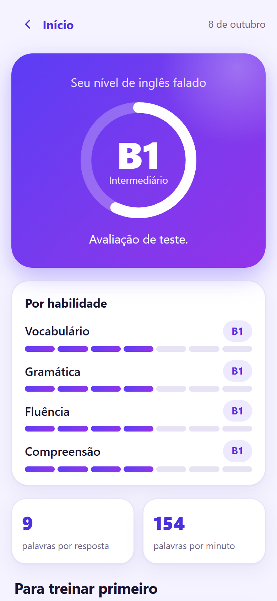
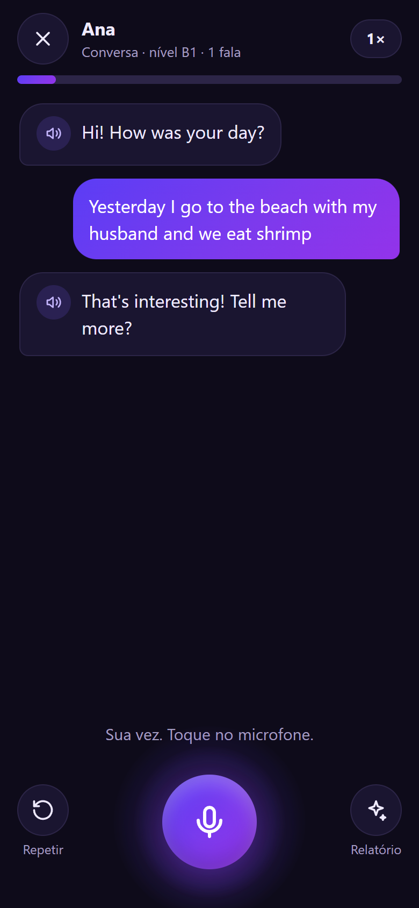
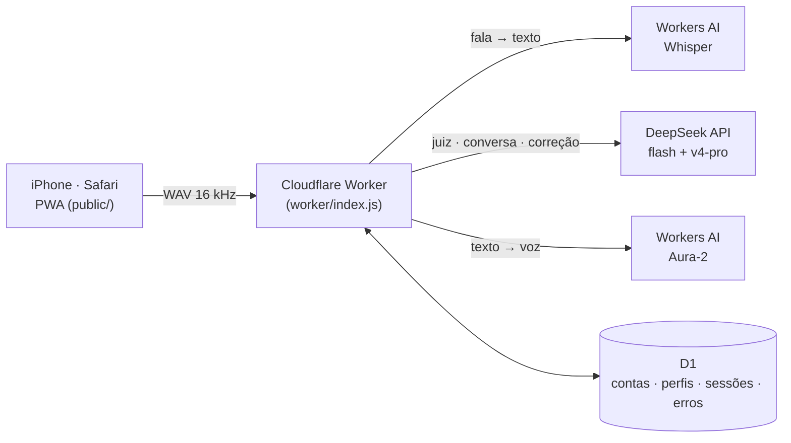

# Stepwise

**Conversação em inglês com IA, para brasileiros.** Uma prova de nível feita só falando, na escala CEFR
(A1 a C2), e depois conversas por voz em que a IA corrige o que importa e lembra dos seus erros na próxima vez.

Gratuito. Roda no navegador do celular e foi pensado primeiro para o iPhone.

**[stepwise.growthtechinovasion.workers.dev](https://stepwise.growthtechinovasion.workers.dev)** · em fase de teste

<table>
  <tr>
    <td></td>
    <td></td>
    <td></td>
    <td></td>
  </tr>
  <tr>
    <td align="center"><sub>Capa</sub></td>
    <td align="center"><sub>Início (tema escuro)</sub></td>
    <td align="center"><sub>Resultado da prova</sub></td>
    <td align="center"><sub>Conversa por voz</sub></td>
  </tr>
</table>

<sub>Prints tirados do app rodando no PC em modo de teste (IA trocada por respostas fixas), no tamanho de um
iPhone. Por isso o resultado diz "Avaliação de teste" e a conversa não mostra correção.</sub>

---

## O problema

Quem estuda inglês no Brasil costuma ler e escrever bem melhor do que fala. Falta prática de conversa, e falta
saber em que nível se está de fato. Teste de nível online costuma ser de múltipla escolha, e mede gramática,
não fala. Aula de conversação é cara e tem hora marcada.

O Stepwise começou como um app de casa, para uma pessoa da família praticar. A pergunta era se dá para usar
IA para fazer as duas coisas com honestidade: **medir o nível falado** e **conversar corrigindo**, num
celular, sem instalar nada.

## O que ele faz

1. **Prova de nível em ~10 minutos, só falando.** Um aquecimento, uma escada adaptativa de perguntas e uma
   escuta. No fim, um nível geral e um por habilidade (vocabulário, gramática, fluência, compreensão), com as
   três coisas para treinar primeiro.
2. **Conversa por voz sobre um tema** (dia a dia, viagem, trabalho, livre). A IA fala, a pessoa responde
   falando, e cada fala volta com a correção do que importa: no máximo dois erros por fala.
3. **Memória de erros.** Os erros mais repetidos voltam no começo da conversa seguinte, e a IA puxa assunto
   para a pessoa praticar justamente aquilo.
4. **Vários perfis na mesma conta**, cada um com nível, provas e erros próprios. Serve para duas pessoas que
   dividem o mesmo celular.

## Decisões de projeto (e por quê)

### A nota é a mediana de três correções, não uma

Modelo de linguagem oscila. Corrigindo a mesma prova duas vezes, ele pode dar A2 numa e B1 na outra, e uma
nota que muda sozinha acaba com a confiança no app. Por isso o modelo de avaliação corrige a prova inteira
**três vezes, em paralelo e de forma independente**, com uma rubrica fixa, e a nota é a **mediana** em cada
habilidade. Com só duas rodadas válidas, fica a menor, para não promover ninguém por empate. A diferença
entre as três fica guardada, para calibrar a prova depois.

### Duas medidas que não dependem uma da outra

Além da correção pela IA, o app mede a fala **sem IA**, a partir do tempo de cada palavra que o Whisper
devolve: palavras por resposta, palavras por minuto, pausas longas e hesitações (*um, uh, é…*). Se a escada
de perguntas e o avaliador discordam em dois níveis ou mais, o resultado vale, mas o app sugere refazer a
prova em alguns dias.

### A prova é adaptativa e às cegas

A escada começa em A2. Quem passa sobe um nível, quem cai duas vezes no mesmo nível fixa o teto, e se a
pessoa nunca passou no nível de baixo a prova desce para conferir. Durante a prova a IA não corrige nada e o
app não mostra se a pessoa passou: ela só reage ao que foi dito, como numa prova de verdade. A pergunta de
cada nível muda a cada prova refeita, para ninguém decorar as perguntas.

### Gravar WAV na mão, e não com o `MediaRecorder`

No iPhone o `MediaRecorder` grava em AAC e no Chrome em Opus. Em vez de tratar cada formato, o app grava
**WAV 16 kHz mono** com um `AudioWorklet`, igual nos dois navegadores. O arquivo fica maior (~32 KB por
segundo), mas um minuto de fala cabe com folga. O iPhone tem duas regras que o código respeita: o áudio só
nasce dentro de um toque do usuário, e o microfone é fechado a cada fala, porque com ele aberto o iOS manda a
voz da IA para o alto-falante de ligação, baixinho.

### Tocar para falar, não segurar

Segurar um botão no iOS abre o menu de seleção de texto, e quem está pensando no que dizer em outra língua
precisa de tempo. Um toque começa a gravar e outro envia.

### Login aberto, com três tetos de gasto

Qualquer conta Google entra. Como cada fala custa transcrição, resposta e voz, o gasto é segurado por três
travas na configuração: **50 contas no máximo**, **300 falas por dia por conta** e **800 falas por dia
somando todas**. A última protege a parte de voz, que é cobrada fora do saldo da API de texto.

### Modelos diferentes para tarefas diferentes

A IA de texto é a **DeepSeek**. O **`deepseek-flash`, com o raciocínio desligado**, conversa e julga cada
resposta da prova, porque precisa ser rápido e barato. O **`deepseek-v4-pro`, com raciocínio**, faz a correção
final, que pede mais critério e roda uma vez por prova. Toda a IA de texto fica num módulo só
(`worker/ia.js`), então trocar de modelo é mudar uma variável. O app começou no Claude e trocou de provedor
mexendo só nesse arquivo.

### A resposta da IA é conferida antes de ser usada

O modo JSON da DeepSeek garante JSON válido, mas não garante o formato. Por isso o schema de cada resposta vai
escrito no prompt, e o Worker confere o que voltou: campo faltando, tipo errado ou nível fora da escala CEFR
contam como falha, e a pergunta é refeita (até 3 vezes, junto com servidor ocupado e queda de rede). Nível com
a caixa trocada (`b1`) é consertado em vez de recusado. A ligação tem uma suíte própria, sem rede, com o
`fetch` simulado.

## Arquitetura



- **Front:** HTML, CSS e JavaScript puros, sem framework e sem etapa de build. É um PWA que se instala pela
  tela de início do Safari.
- **Back:** um Cloudflare Worker com banco D1 (SQLite). Login com Google e sessão em cookie assinado por
  HMAC. O "Sair" revoga todos os cookies anteriores daquela conta.
- **Voz:** Whisper para ouvir (com o tempo de cada palavra) e Aura-2 para falar, os dois no Workers AI. A IA
  de texto recebe só a transcrição: o áudio não é guardado.
- **Segurança:** cada conta só enxerga os próprios perfis e sessões (provado nos testes), há
  Content-Security-Policy na página, e o login de teste sem Google só funciona em `localhost`.

## Testes

```bash
npm run teste   # 165 provas: 59 de regras + 45 da ligação com a IA + 51 de ponta a ponta + 10 do login aberto
```

- **Regras** (`teste-regras.mjs`): a escada da prova, as medidas de fluência e a nota final, como funções
  puras.
- **Ponta a ponta** (`teste-rota.mjs`): sobe o Worker de verdade num banco descartável e percorre login,
  isolamento entre contas, uma prova inteira, conversa com memória de erros, limite diário e "Sair".
- **Login aberto** (`teste-aberto.mjs`): o teto de contas e o fato de a conta antiga continuar entrando com
  o teto cheio.

Tudo roda em **modo falso**: a IA é trocada por respostas fixas e nada sai da máquina, então a suíte é
grátis e dá o mesmo resultado sempre.

## O que ainda não se sabe

Isto está em teste, e eu prefiro dizer o que falta:

- **A nota nunca foi calibrada** contra pessoas de nível conhecido. O próximo passo é gravar de 3 a 5 pessoas
  com nível certificado e ver se a nota bate.
- **O Whisper "limpa" a fala:** ele tende a escrever o que a pessoa quis dizer, e isso esconde erros de
  gramática. Os prompts avisam disso, mas é uma limitação real.
- **Os critérios de cada nível são paráfrases** dos descritores do CEFR para produção oral, não o texto
  oficial do Conselho da Europa.
- **Custo estimado, ainda não medido:** perto de US$ 0,15 a 0,20 por prova e de US$ 0,15 por conversa de 20
  falas.

## Rodar no seu computador

```bash
npm install
cp .dev.vars.exemplo .dev.vars   # MODO_LOCAL=1 e, sem chave, IA_FALSA=1
npm run db:local
npm run worker:dev               # http://localhost:8810 → "Entrar (modo local)"
```

O microfone funciona em `localhost`. No celular, só com HTTPS.

## Stack

Cloudflare Workers · D1 · Workers AI (Whisper, Aura-2) · DeepSeek API (flash, v4-pro) · JavaScript puro ·
Web Audio API (`AudioWorklet`) · PWA

---

Feito por **[Ronny Arruda](https://github.com/ronnyarruda20)**.
